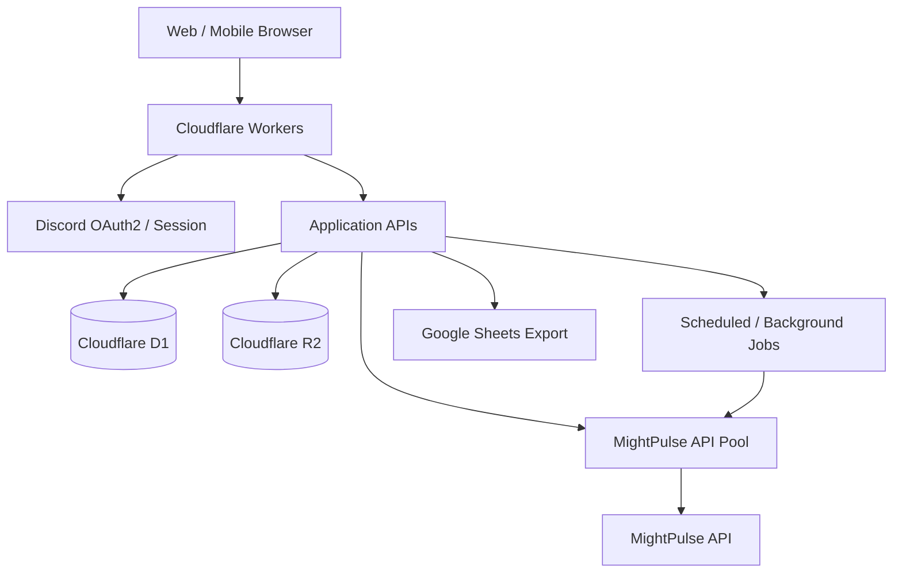

# EagleEye — KingShot Data Platform

  <strong>ゼロから設計・開発する、KingShot向けデータ分析・監視プラットフォーム</strong> 
  <a href="https://eagleeye-ks.com">公式サイト</a> ·
  <a href="https://github.com/kingshot-bj/kingshot-data-platform">Source Code</a>

EagleEyeは、モバイルゲーム **KingShot** のプレイヤー・同盟・王国データを集約し、検索、比較、ランキング分析、継続監視に活用するWebプラットフォームです。

単なる攻略情報サイトではなく、外部APIからのデータ取得、キャッシュ・永続化、権限管理、バックグラウンド処理、運用監視までを一体として設計しています。

> **Project role:** Project creator / Product & Technical Lead  
> プロダクト構想、要件定義、機能優先順位、データ設計・運用方針、技術的な意思決定を主導。実装ではAIコーディングツールも活用し、コードレビュー・検証・改善を繰り返しています。

---

## What it does

| Area | Capability |
|---|---|
| Player intelligence | プレイヤー検索、プロフィール、英雄・領主装備・ランキング情報 |
| Comparison | 複数プレイヤーの比較、比較結果の共有 |
| Kingdom intelligence | 王国ランキング、王国単位のデータ分析 |
| Alliance intelligence | 同盟情報・メンバー情報の確認と比較 |
| Watchlists | プレイヤー／王国の監視、定期更新、変化の追跡 |
| Access control | BASIC / ADVANCED / ADMIN / OWNER のロール別アクセス制御 |
| Operations | API Pool、管理者向け診断、取得状況・システム状態の可視化 |
| Data export | 権限に応じたGoogle Sheets連携 |

機能の公開範囲やデータの鮮度は、アカウント権限・取得元API・保存状況によって異なります。

## Engineering highlights

### 1. External API integration and key-pool orchestration

- MightPulse APIをCloudflare Worker側から呼び出すサーバーサイド構成
- APIキーをプールとして管理し、リース・成功／失敗記録・クールダウンを制御
- キーの同時利用を考慮した取得制御と共通コレクション処理
- タイムアウト、リトライ、429 / 5xx、上流APIエラーの分類
- 取得処理を共通ガードに集約し、機能ごとの個別実装を抑制

### 2. Data architecture under constrained resources

- Cloudflare D1を検索・権限・最新データなどのアプリケーションDBとして利用
- Cloudflare R2をデータ保管・アーカイブ用途に活用
- 最新値と履歴・スナップショットの役割を分離
- D1の読み書き量を意識し、不要な全件取得や重複取得を避ける設計を重視
- Retention（保持期間）を前提に、データが増え続けることへの対策を実装

### 3. Monitoring and background processing

- プレイヤー／王国のWatchlist
- Cron・バックグラウンドジョブによる定期更新
- API Poolの空き状況を踏まえた取得量・並列数の調整
- ジョブ状態・失敗理由・外部APIの実行状況を追跡する診断機能

### 4. Authentication and authorization

- Discord OAuth2を利用したログイン
- セッション管理とサーバー側での権限チェック
- BASIC / ADVANCED / ADMIN / OWNER のロールモデル
- 画面上の表示制御だけでなく、API側でもアクセス権を検証

### 5. Product-focused UI

- iPhone Safariを含むモバイル利用を重視
- ライト／ダークテーマ
- 日本語表示とゲーム内データに合わせた用語整理
- 比較結果の共有など、分析結果を他のプレイヤーへ伝えやすいUI

---

## Architecture

### Technology

- **Runtime / API:** Cloudflare Workers
- **Database:** Cloudflare D1 (SQLite)
- **Object storage:** Cloudflare R2
- **External data:** MightPulse API
- **Authentication:** Discord OAuth2
- **Export integration:** Google Sheets API
- **Source control:** GitHub

Browser clients do not call the external game-data provider directly. Provider credentials and data collection are handled server-side.

## Selected engineering principles

- **Correctness over guesswork:** Do not invent unavailable game statistics. Preserve source data and distinguish observed values from derived values.
- **Cost-aware design:** Treat database reads/writes, API quotas, concurrency, and storage as design constraints—not afterthoughts.
- **Least privilege:** Separate data visibility, administrative capabilities, and export permissions.
- **Operational visibility:** Make background jobs, API failures, and resource usage diagnosable.
- **Incremental change:** Prefer shared primitives and small, verifiable changes over risky rewrites.
- **Mobile-first usability:** Treat mobile Safari as a primary environment.

## Repository map

| Path | Responsibility |
|---|---|
| `src/index.js` | Worker entrypoint, routes, application UI and request handling |
| `src/mightpulse.js` | MightPulse API client |
| `src/data-collection-engine.js` | Guarded data collection and API Pool integration |
| `src/api-pool.js` | API key pool and lease management |
| `migrations/` | D1 schema migrations |
| `tests/` | Automated tests and regression checks |
| `docs/` | Architecture notes, engineering decisions and handoff documents |
| `wrangler.jsonc` | Cloudflare Worker configuration |

## Project status

EagleEye is actively developed. The `main` branch is the production-oriented baseline; feature branches and pull requests may contain work that has not yet been merged or deployed.

A GitHub commit or merged pull request does not, by itself, prove that a change is live in production. Deployment and runtime verification are tracked separately.

## Development and security

- Never commit API keys, OAuth secrets, private keys, or production credentials.
- Store secrets in Cloudflare secrets or approved server-side encrypted storage.
- Review D1 migrations before applying them to production.
- Validate API response shapes before changing persistence or UI contracts.
- Check tests, deployment output, and runtime behavior before describing a feature as production-ready.

## About this project

EagleEye is an independent project built around a real operational use case in the KingShot community. Its development combines product planning, backend architecture, data engineering, API integration, mobile UI design, and ongoing operations.

AI-assisted development tools are used as implementation support. Product direction, requirements, prioritization, acceptance decisions, and project ownership are led by the project creator.

---

日本語での開発経緯・詳細な仕様引継ぎは `docs/` 以下を参照してください。古いチャット引継ぎ資料は履歴として `docs/archive/` に保存しています。
