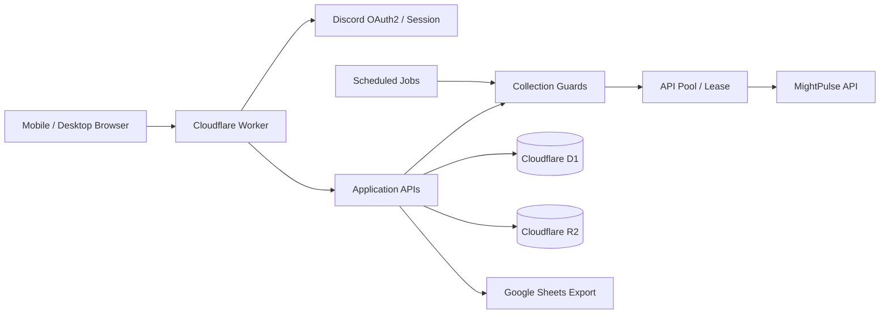

# EagleEye — Engineering Case Study

> Public project overview for engineers reviewing the architecture, engineering decisions, and product ownership behind EagleEye.

## 1. Project context

EagleEye is a data analysis and monitoring platform for the KingShot game community. The product combines player and alliance lookup, kingdom rankings, player comparison, watchlists, and administrative operations.

The engineering challenge is broader than rendering game data. The system must collect data from an external provider, handle API quotas and key availability, persist useful snapshots, serve users with different permissions, and remain operable under constrained serverless database and execution resources.

## 2. Role and ownership

**Project creator / Product & Technical Lead**

Responsibilities led by the project creator:
- Product vision, user requirements, and feature prioritization
- System-level architecture and integration decisions
- Data freshness, persistence, and resource-cost policies
- Permission model and administrative workflows
- Mobile UX direction and acceptance criteria
- Operational issue triage and release decisions

AI coding tools have been used to accelerate implementation. They are treated as development assistants; generated changes are reviewed and validated as part of the project workflow. This distinction is intentional: project ownership and technical direction are not the same as claiming every line of code was manually authored.

## 3. Selected engineering problems and approaches

### External API quota and concurrency management

**Problem:** Multiple application features need data from an external API. Uncoordinated requests can exhaust available keys, collide under concurrency, or create inconsistent error handling.

**Approach:**
- Centralize outbound requests in a shared MightPulse client.
- Manage API keys through a pool with lease-based allocation.
- Record success/failure and apply cooldown behavior.
- Reuse a guarded collection primitive for semaphore control, key leasing, upstream calls, and accounting.
- Keep request timeout and retry behavior explicit.

**Engineering value:** Provider integration becomes a platform capability rather than a collection of unrelated per-page fetch calls.

### Database and storage cost management

**Problem:** Ranking snapshots, player monitoring, and repeated refreshes can create substantial database reads and writes.

**Approach:**
- Use D1 for application state, permissions, lookup, and current data.
- Use R2 for suitable object/archive storage.
- Separate current-state reads from historical snapshot handling.
- Apply retention policies to limit unbounded growth.
- Evaluate the cost of polling, fan-out, and repeated reads before adding scheduled work.

**Engineering value:** Resource usage is considered at the data-flow and feature-design level.

### Reliable background monitoring

**Problem:** Watchlist jobs can overlap, compete for API keys, or continue when capacity is unavailable.

**Approach:**
- Use scheduled/background processing rather than tying every refresh to a browser request.
- Track job state and per-target refresh state.
- Coordinate concurrency with available API Pool capacity.
- Preserve per-target diagnostics so failures can be investigated.

**Engineering value:** Monitoring is designed as an operational subsystem, not merely a timer that repeatedly calls an endpoint.

### Authorization boundaries

**Problem:** Hiding a button in the UI is not sufficient protection for privileged data or exports.

**Approach:**
- Use explicit BASIC / ADVANCED / ADMIN / OWNER roles.
- Separate data visibility from administrative actions.
- Enforce authorization at API boundaries as well as in the UI.
- Keep provider credentials and privileged integrations server-side.

**Engineering value:** Access control is part of the application architecture rather than a presentation-only concern.

## 4. Architecture at a glance

## 5. Technology choices

| Layer | Technology | Purpose |
|---|---|---|
| Application runtime | Cloudflare Workers | Server-side routes and application logic |
| Relational data | Cloudflare D1 | Application state, lookup, permissions, snapshots |
| Object storage | Cloudflare R2 | Archive/object storage |
| Data provider | MightPulse API | Game data source |
| Authentication | Discord OAuth2 | User sign-in |
| Export | Google Sheets API | Admin-oriented data export |
| Source management | GitHub | Version control and review |

## 6. Engineering principles

1. **Source fidelity:** Do not fabricate missing game data or present inferred values as official values.
2. **Cost awareness:** Measure and reason about D1 reads/writes, API quota, storage, and concurrency.
3. **Shared infrastructure:** Centralize cross-cutting concerns such as API retries, key leasing, and collection guards.
4. **Defense in depth:** Enforce permissions on the server, not only in the UI.
5. **Operational observability:** Preserve enough job and API diagnostics to explain failures.
6. **Incremental delivery:** Prefer reviewable changes with explicit validation over broad rewrites.
7. **Mobile-first product quality:** Design and verify key workflows for iPhone Safari as well as desktop.

## 7. Evidence and review

The repository's commit history, pull requests, migrations, tests, and architecture notes provide the implementation history. Reviewers should distinguish:
- merged code from open pull requests,
- committed code from deployed code,
- automated checks from production runtime verification,
- source API fields from EagleEye-derived presentation values.

The README is the concise public entry point. Detailed internal handoff notes and dated investigation records are retained under `docs/` and `docs/archive/` for traceability.

## 8. Current limitations

- The project depends on the availability, quota, response schema, and freshness behavior of its external data provider.
- Serverless database and execution limits influence refresh frequency and data-retention choices.
- Not every experimental branch or open pull request is part of the production baseline.
- Deployment status must be verified independently from Git history.

These constraints are documented because engineering trade-offs are part of the work, not details to hide from reviewers.
